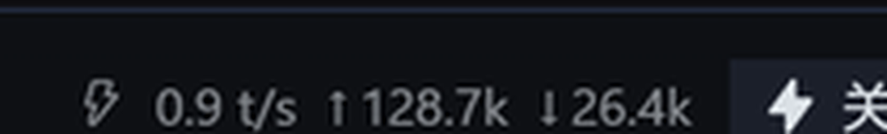

# Token Speed

Live **token generation speed** and **session up/down token totals** in the Hermes Desktop status bar — plus a click-through dashboard.



`⚡ 38.4 t/s  ↑12.4k  ↓3.2k` sits in the status bar while you work. Click it for the full picture:


## What it shows

| Surface | Values |
|---|---|
| Status bar chip | current tokens/sec, `↑` prompt tokens used this session, `↓` completion tokens this session |
| Dashboard (click the chip) | 60-second sparkline, this-turn output tokens, model, call count, average t/s, cache hit %, context usage %, estimated cost (USD) |
| Command palette | `Token Speed: reset samples` — clears the sliding window and history |

Speed reads `0` and the chip goes quiet when nothing is streaming. No spinner, no flicker.

## Install

Catalog (once listed):

```bash
hermes plugins install token-speed
```

From source:

```bash
hermes plugins install https://github.com/seagull/hermes-token-speed
```

Manual, desktop-only (works without any agent-side plugin machinery): copy `desktop/plugin.js` to
`$HERMES_HOME/desktop-plugins/token-speed/plugin.js` and restart Desktop. That directory is app-wide, so every
profile sees the same copy.

Then enable it in **Settings → Plugins**.

## How the number is produced

The plugin never guesses from a clock alone and never asks the model for a rate:

1. `message.delta` / `reasoning.delta` frames feed a 2-second sliding window of character counts
   (`thinking.delta` is deliberately excluded — the core rewrites it with spinner frames, not real output).
2. A 250 ms tick converts chars → tokens with a **learned** chars-per-token ratio.
3. `UsageStats` ticks (authoritative `input`/`output`) recalibrate that ratio continuously
   (exponential smoothing, 0.65/0.35), clamped to 0.7–12 chars/token so CJK-heavy (~1.2) through
   English code (~4.5) both track and a miscount can't poison it.
4. Between frames the speed decays geometrically instead of snapping to zero mid-sentence.

`↑` and `↓` are read straight from the session's `UsageStats` — no estimation at all.

## Privacy and footprint

- No network calls. No telemetry. Nothing leaves the machine.
- No file writes, no credential reads, no env vars (`requires_env: []`).
- Only the Desktop plugin SDK (`@hermes/plugin-sdk`, `react/jsx-runtime`); no DOM scraping, no
  prototype patching, no `eval`, no core overrides.
- All state is module-scoped and resets when the app reloads; counters follow the session.

## Compatibility

- Hermes Desktop **>= 0.23.0** (`requires_hermes`).
- Desktop-only: no agent tools, hooks, middleware or provider surfaces. The manifest declares empty
  `capabilities` on purpose — validation fails an entry whose declarations drift from what it registers.

## Layout

```
plugin.yaml         manifest (v2), desktop-only
desktop/plugin.js   the whole plugin: plain ESM, loaded uncompiled (jsx() calls, not JSX syntax)
assets/             screenshots
```

## 中文说明

状态栏实时显示 **token 生成速度** 和 **本会话上下行总数**，点一下看完整面板。

| 位置 | 内容 |
|---|---|
| 状态栏小条 | 当前 tok/s、`↑` 上行（prompt）、`↓` 下行（completion） |
| 点击弹出的面板 | 60 秒柱状图、本轮输出 token、模型、调用次数、均速、缓存命中率、上下文占用、预估成本 |
| 命令面板 | `Token Speed: 清空采样` |

速度靠 2 秒滑动窗口的字符流估算，并用 `UsageStats` 的真实 input/output 持续自校准字符/token 比例
（中英混排都跟得住）；不联网、不写文件、不读凭证，只用插件 SDK。

安装：`hermes plugins install token-speed`，或在 **设置 → 插件** 里启用。

## License

MIT
